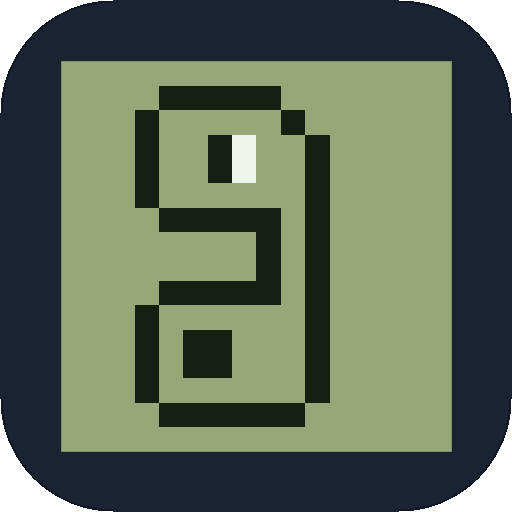

# 🐍 Nokia 3310 Snake II - Retro Edition

A faithful recreation of the classic **Snake II** from the legendary **Nokia 3310** (2000s era), built with modern web technologies and installable as a **Progressive Web App (PWA)** on any smartphone.



---

## 🎮 Features

- **Authentic Nokia 3310 LCD Display**: Olive-green graphic LCD screen with dark charcoal pixels and subtle dot-matrix texture.
- **Lifelike Snake Anatomy**:
  - Continuous, connected slithering body (no disjointed boxes!).
  - Direction-facing head with eyes.
  - Animated forked tongue that periodically darts out.
  - Tapered tail.
- **🌀 Portal / Screen-Wrapping Walls**:
  - Walk through any wall (Top ⟷ Bottom, Left ⟷ Right) seamlessly!
  - Soft portal chirp sound and particle dust on boundary crossing.
- **★ 10-Second Invincibility Power-Up**:
  - Flashing winged golden stars/beetles spawn at random intervals with countdown timers.
  - Grants **+50 bonus points** and **10 Seconds of Invincibility**!
  - Slither safely through your own body coils without crashing!
- **8-Bit Nokia Chiptune Audio**:
  - Classic piezo-speaker sound effects (eat bug, warp, power-up arpeggio, and descending game over tone).
- **📲 Installable Mobile App (PWA / WebAPK)**:
  - Install directly onto Android or iOS home screens as a standalone offline app.

---

## 🕹️ Controls

| Action | Keyboard | Nokia Keypad / On-Screen |
| :--- | :--- | :--- |
| **Move Up** | <kbd>↑</kbd> or <kbd>W</kbd> | <kbd>2</kbd> / <kbd>▲</kbd> |
| **Move Down** | <kbd>↓</kbd> or <kbd>S</kbd> | <kbd>8</kbd> / <kbd>▼</kbd> |
| **Move Left** | <kbd>←</kbd> or <kbd>A</kbd> | <kbd>4</kbd> / <kbd>◀</kbd> |
| **Move Right** | <kbd>→</kbd> or <kbd>D</kbd> | <kbd>6</kbd> / <kbd>▶</kbd> |
| **Start / Pause** | <kbd>Space</kbd> or <kbd>Enter</kbd> | Pause Button |

---

## 📱 How to Play on Your Smartphone (GitHub Pages)

Once this repository has **GitHub Pages** enabled:
1. Go to repository **Settings** ➔ **Pages**.
2. Select `main` branch and `/ (root)`.
3. Open the generated GitHub Pages URL on your phone's browser (e.g. Chrome / Safari).
4. Tap **"📲 Install App"** or the browser menu (`⋮`) ➔ **"Add to Home screen"** / **"Install App"**.
5. The retro Nokia Snake icon will be installed right onto your phone's app screen and work 100% offline!

---

## 📂 Project Structure

```
├── index.html        # Main game logic, audio synthesizer & Nokia handset UI
├── manifest.json     # PWA manifest for standalone app installation
├── sw.js             # Service worker for offline asset caching
├── icon-192.png      # 192x192 Nokia pixel snake app icon
├── icon-512.png      # 512x512 Nokia pixel snake app icon
└── README.md         # Documentation
```
